<a href="https://canessasyslabs.com/phonosphere/"><b>See it on canessasyslabs.com&nbsp;&nbsp;→</b></a>

Phonosphere Studio treats speech synthesis as a performance to direct, not a text box to fill. In the solo studio you choose a voice, set its style and emotional intensity, tune pitch and speed, and mark breaths, laughs and pauses where they belong. In the conversation studio you paste a full two-person script; each line is attributed to its speaker and the whole conversation is voiced under one style direction. A sounds studio designs one-shots and loops in the browser, and Phono, the studio companion, guides you through all three. When the daily quota runs out, a browser-voice fallback keeps you working.

Phono greets you on your first visit, walks you through the three studios and stays in the corner while you work, speaking short prompts in a warm, plain voice. Each mood has its own face; motion only signals that Phono is speaking or that audio is playing.

© Canessa System Labs. All rights reserved. This repository presents the work; it does not license it. No part of its text, images or design may be reused without written permission.

